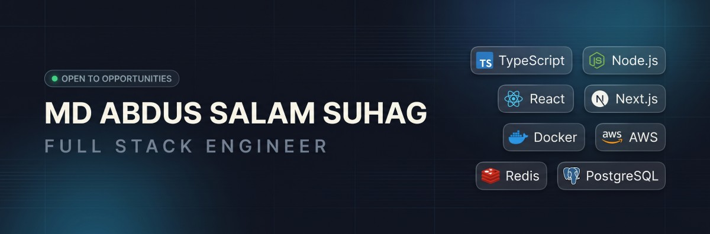

  

 

  
  
  

---

## What I Do

I build **production-grade backend systems** and **full-stack applications** that handle real traffic, real payments, and real-time interactions. My work spans multi-vendor marketplaces, on-demand service platforms, UK tradesperson lead engines, and web apps — all deployed on cloud infrastructure with proper CI/CD pipelines.

**Core focus areas:**

- **Backend Architecture** — Scalable REST APIs, microservices patterns, background job queues (BullMQ), caching layers (Redis), and full-text search (Elasticsearch)
- **Payment Engineering** — Stripe Connect split payouts & escrow, Google Play / App Store in-app subscription verification, PayPal, SSLCommerz, Hubtel
- **Real-time Systems** — WebSocket clusters with Socket.io, live video streaming with Agora, real-time bidding engines
- **Cloud & DevOps** — AWS deployments, Docker containerization, Terraform IaC, automated CI/CD
- **AI Integration** — OpenAI & Gemini API integration, Agentic AI workflows for intelligent automation

---

## Featured Projects

### 🔵 Trade Link Network — _UK Tradesperson Lead Engine_

A UK-focused leads marketplace connecting homeowners with local trade professionals (plumbers, electricians, roofers). Built lead distribution engine, automated matching algorithms, Stripe payment processing, and admin analytics dashboard.

`TypeScript` `Node.js` `Express` `MongoDB` `Mongoose` `Redis` `Stripe` `Socket.io` `Next.js` `Twilio`

 

---

### 🔴 Ways2Shop — _On-Demand Service Marketplace App_

A cross-platform mobile marketplace connecting customers with verified professional service providers. Engineered the complete backend API, server-side subscription validation handlers for Google Play (RTDN) & Apple StoreKit 2, multi-party escrow payouts via Stripe Connect, and real-time chat with Socket.io.

`TypeScript` `Node.js` `Express` `MongoDB` `Socket.io` `Stripe Connect` `In-App Purchases` `Redis`

  

---

### 🟢 Gcom — _Multi-vendor Hyper-local eCommerce & Services_

A comprehensive multi-vendor platform digitizing retail, hospitality, and service bookings in Ghana. Engineered distributed backend with Redis caching, multi-party escrow transactions and automated vendor withdrawals integrated with Hubtel gateway, and asynchronous background worker queues with BullMQ.

`TypeScript` `Node.js` `Express` `MongoDB` `Redis` `BullMQ` `Socket.io` `Hubtel Gateway` `Cloudflare R2` `AWS`

  

---

### 🛒 Tech Space — _Scalable eCommerce_

Full-stack eCommerce platform with role-based admin/customer dashboards, SSLCommerz payment integration, and responsive storefront.

`React` `Redux` `Express` `MongoDB` `Shadcn UI` `SSLCommerz`

 

---

## Tech Stack

<table>
  <tr>
    <td><b>Languages</b></td>
    <td>
      
      
      
    </td>
  </tr>
  <tr>
    <td><b>Backend</b></td>
    <td>
      
      
      
      
    </td>
  </tr>
  <tr>
    <td><b>Frontend</b></td>
    <td>
      
      
      
      
    </td>
  </tr>
  <tr>
    <td><b>Databases</b></td>
    <td>
      
      
      
      
      
    </td>
  </tr>
  <tr>
    <td><b>Payments</b></td>
    <td>
      
      
      
      
      
    </td>
  </tr>
  <tr>
    <td><b>Cloud & DevOps</b></td>
    <td>
      
      
      
      
    </td>
  </tr>
  <tr>
    <td><b>AI</b></td>
    <td>
      
      
    </td>
  </tr>
  <tr>
    <td><b>Tools</b></td>
    <td>
      
      
      
      
    </td>
  </tr>
</table>

---

## GitHub Stats

  
  

  

---

  <b>Open to opportunities — let's build something that scales.</b> 
  <a href="mailto:abdussalamsuhag104@gmail.com">abdussalamsuhag104@gmail.com</a> · <a href="https://www.linkedin.com/in/suhag102/">LinkedIn</a> · <a href="https://mdsuhag.vercel.app">Portfolio</a>

<!-- 

  

 -->
